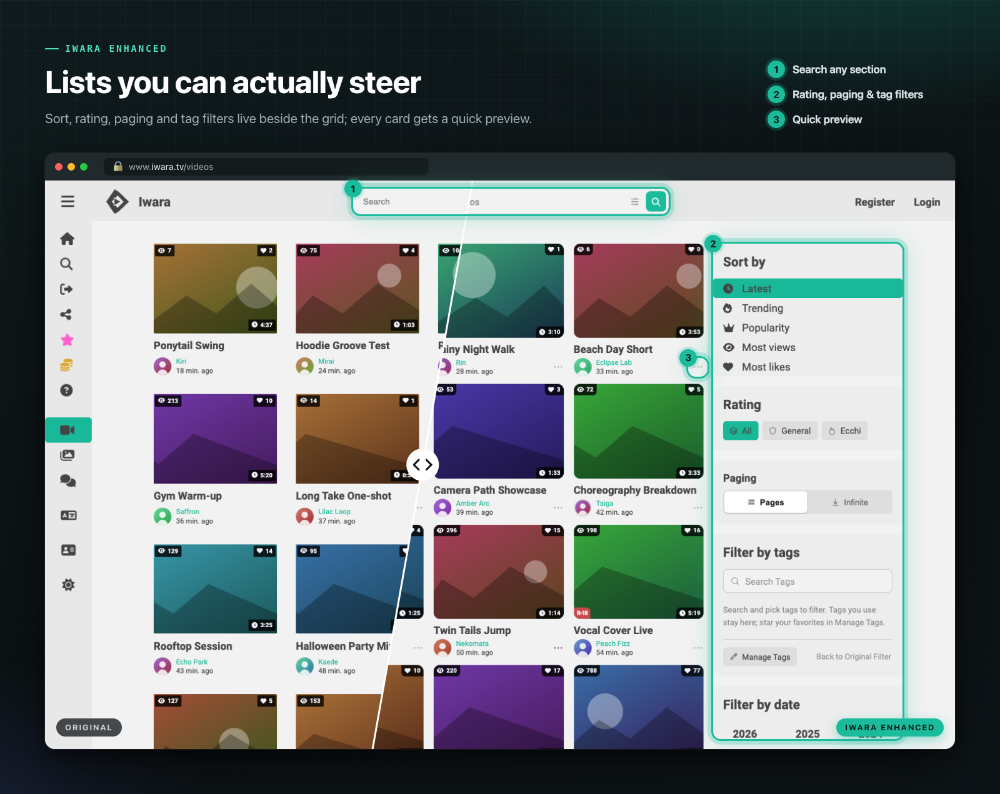
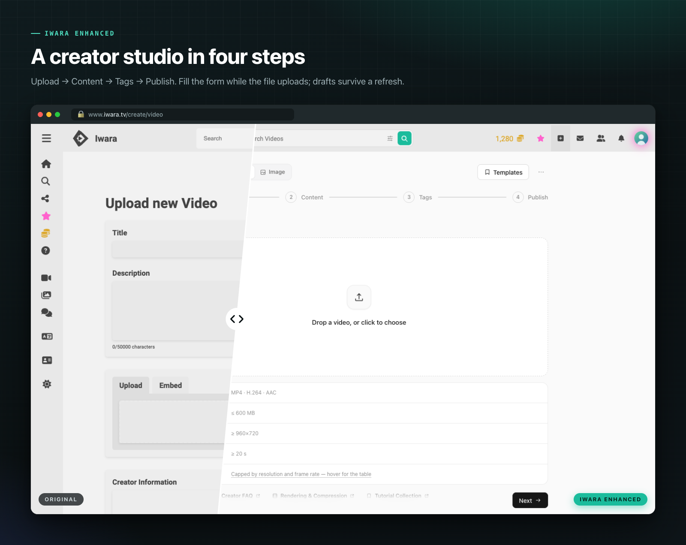
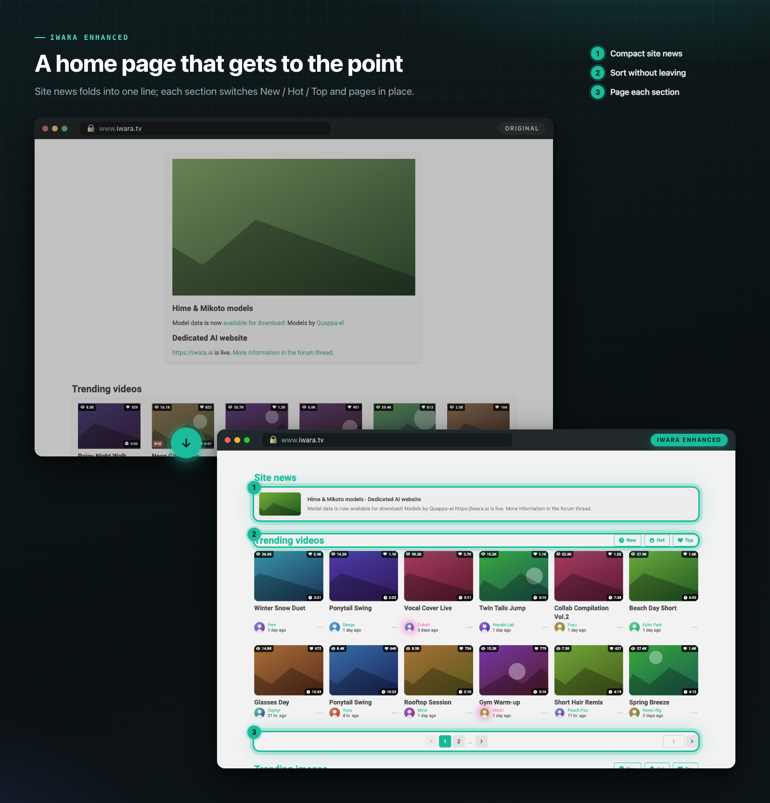
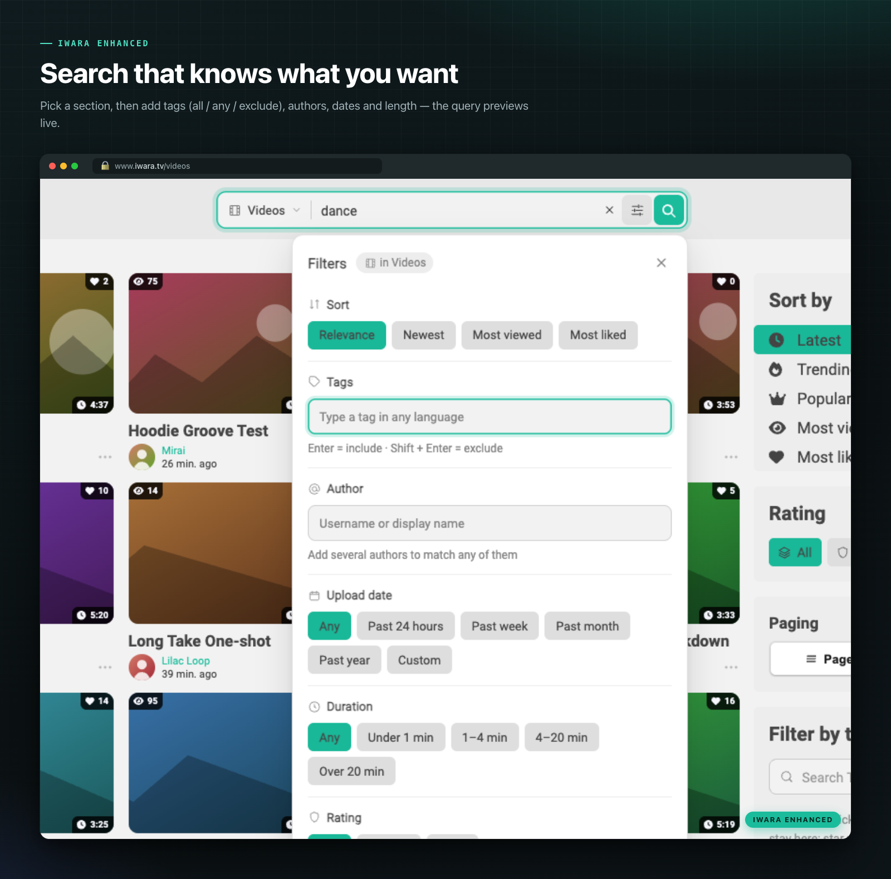
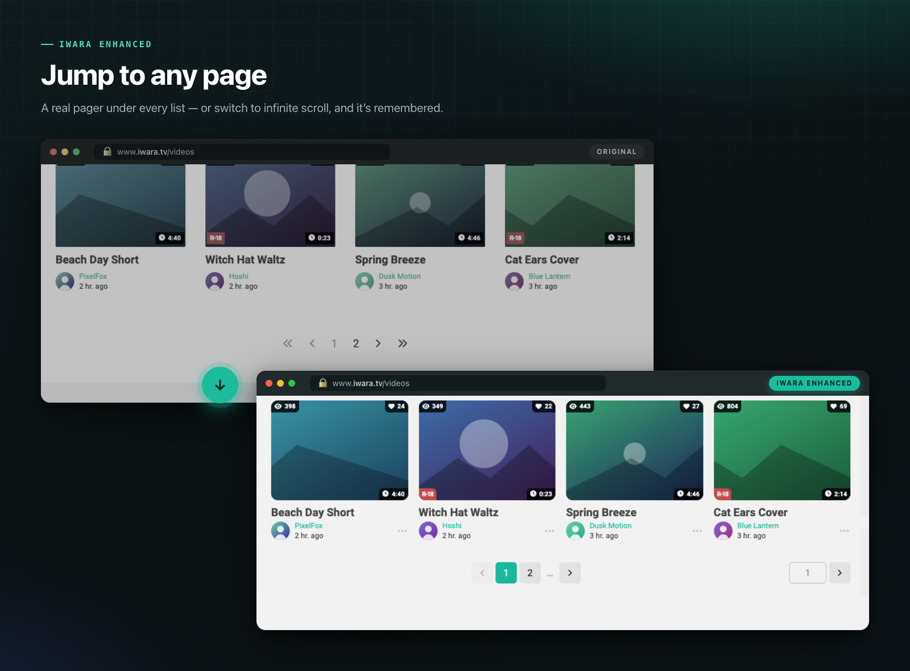
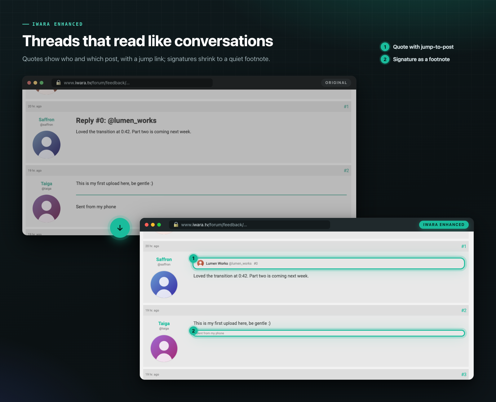
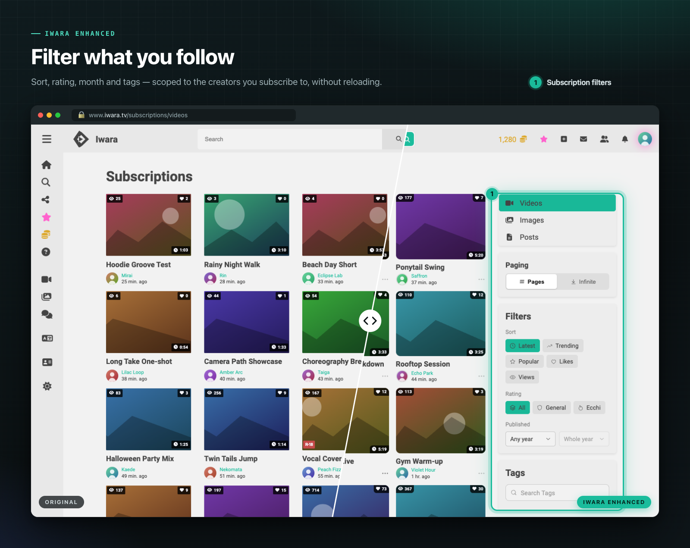
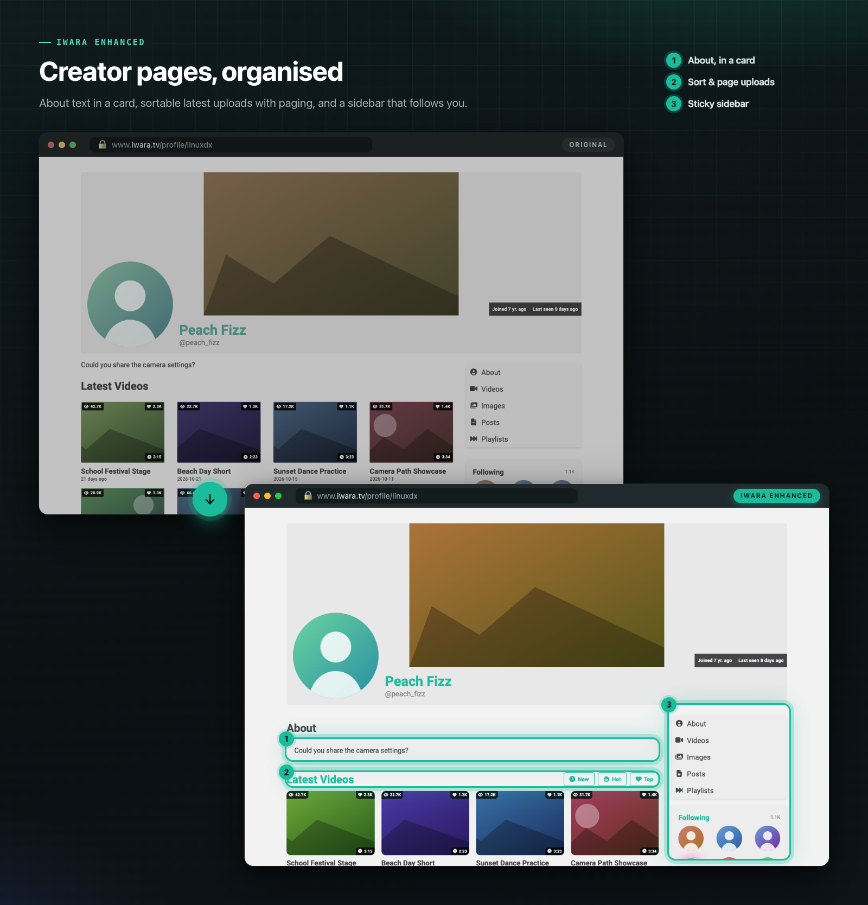
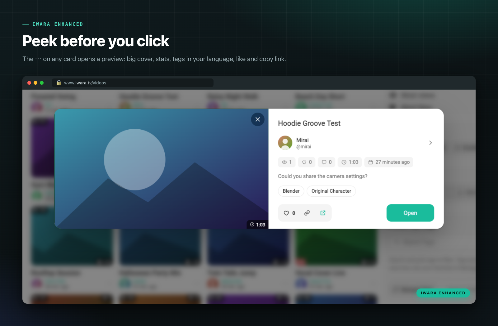
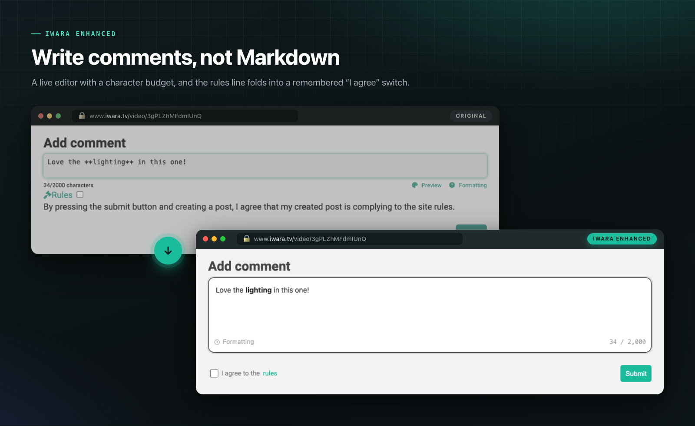

<div align="center">

# Iwara Enhanced

**iwara.tv をもっと見やすく、もっと投稿しやすくする非公式ユーザースクリプト。**

[English](README.md) · [简体中文](README.zh-CN.md) · **日本語**

[](LICENSE)
[](https://www.tampermonkey.net/)
[](https://www.iwara.tv)

</div>

<p align="center"></p>

---

## 🌟 概要

**Iwara Enhanced** は iwara.tv 公式サイト向けのコミュニティ製ユーザースクリプトです。元のページはそのまま使える状態を保ちつつ、投稿者と視聴者のための機能を足します：スムーズな投稿フロー、扱いやすい作品管理、便利な検索と閲覧。

> [!NOTE]
> これは非公式のコミュニティプロジェクトで、Iwara 公式とは一切関係ありません。

> [!IMPORTANT]
> **ルールを守ってください** — Iwara のサイトルールとコンテンツポリシーに従ってください。違反（テスト用や未完成の作品のアップロードなど）はアカウントの警告や制限につながることがあります。

> 以下のスクリーンショットはすべて実際の iwara.tv を、同じ**架空のデータ**で「元のサイト」と「スクリプト適用後」の 2 通りに描画したものです。タイトル・ユーザー名・説明・タグ・カバー・アイコンはダミーです。画面は英語表示で統一しています。

## ✨ 機能

### 🖊️ クリエイタースタジオ

動画・画像の投稿ページ、編集ページ、作品管理ページを、ひとつのステップ式フローにまとめます。

<p align="center"></p>

- **4 ステップで公開**：アップロード → 内容 → タグ → 公開
  - 動画は選んだ瞬間にアップロード開始。アップロード中にフォームを入力できます
  - アップロード完了後は下書きに保存され、ページを再読み込みしてもやり直し不要
- **見たまま編集**
  - 中身は Markdown（Enter で段落、Shift+Enter で改行）
  - `@` でユーザーをメンション、自分の作品を引用
  - `Tab` で次の穴埋め箇所へ移動
- **スマートなタグ入力**
  - 英語・簡体字・繁体字・日本語で検索
  - 動画とギャラリーはそれぞれカテゴリーを 1 つ選択
  - 使ったタグは「最近使ったタグ」に残ります
  - 辞書は [LoveIwara](https://github.com/FoxSensei001/LoveIwara/tree/master/tool/data/iwara_tags) の `tool/data/iwara_tags` から。英語以外は機械翻訳です
- **カバー**
  - サーバーが生成した候補フレームから選択
  - プレミアム会員は独自のカバーもアップロード可能
- **テンプレート**
  - タイトルに `{穴埋め}` と自動で連番になる `{#}` を使えます
  - どのステップでもテンプレートを適用
  - 公開の前でも後でも、今の内容を新しいテンプレートとして保存
- **作品管理**
  - カバー付きのカード表示
  - 検索・並べ替え・統計
  - 動画とギャラリーそれぞれの投稿クールダウンを表示

### 🏠 ホーム

<p align="center"></p>

- サイトのお知らせを 1 行にコンパクトにまとめます。
- 各セクション（動画・画像など）はその場で 新着 / 人気 / トップ を切り替え、ページ送りもできます。

### 🔍 検索

<p align="center"></p>

- ヘッダーの検索ボックスで、先に対象（動画・ギャラリー・投稿・ユーザーなど）を選べます。検索結果ページには専用の検索バーがあるため、そこではヘッダーの検索ボックスを隠します。
- 検索結果ページでは、検索ボックスに今入っている文字がキーワードになります。キーワードを消してから絞り込みを変えると、絞り込み条件だけで検索します。
- 詳細パネルでは複数タグ（すべて / いずれか）、除外タグ、作者、完全一致フレーズ、日付、レーティング、並び順を指定でき、組み立てられる検索クエリをリアルタイムでプレビューします。

### 📄 ページ送り

<p align="center"></p>

- 一覧ページに、任意のページへ移動できる通常のページ送りを追加します。
- 動画・ギャラリー一覧は無限スクロールにも切り替えられ、選択は記憶されます。

### 👤 ユーザー表示

- アイコンに立場ごとのリングを表示：プレミアム会員はやわらかく光るグラデーション、管理者は赤、モデレーターは緑、制限中のユーザーはグレー。
- プロフィールに立場のバッジを表示します。

### 💬 コメントと投稿の表示

<p align="center"></p>

- フォーラムの引用を、アイコン・名前・「その投稿へ移動」リンク付きの引用バーとして表示します。
- 署名はグレーの小さな脚注に、サイト内の絵文字は適切な大きさで表示します。
- 変わるのは表示だけで、送信内容には手を加えません。

### 🏷️ タグの翻訳と絞り込み

- 動画・ギャラリーなどのページのタグリンクを、今の表示言語で表示します（辞書から）。マウスを乗せると原文を確認できます。
- 動画・ギャラリー一覧を複数タグ（すべて）で絞り込めます。候補は最近使ったタグと、表示中の一覧に含まれるタグです。

### 📬 フォロー中（購読）ページ

<p align="center"></p>

- 購読ページの動画・画像タブの右側に「絞り込み」と「タグ」の 2 枚のカードを追加：並び順（既定は「新着」、ほかにトレンド / 人気 / いいね / 再生数）、レーティング（既定はすべて）、投稿年月、タグでの絞り込み（すべて）。各カード右上でワンクリックでリセットできます。
- 絞り込みはフォロー中の作者の範囲だけに効き、ページを再読み込みせずに切り替わります。動画と画像のタブで同じ条件を共有します。
- よく使うタグの組み合わせを保存でき、動画・ギャラリー・購読ページで共通に使えます。
- 動画・ギャラリー一覧の右側には「レーティング」カード（すべて / 全年齢 / R-18）も追加。サイドバーでサイト全体の設定を切り替える必要はなく、既定ではサイドバーの設定に従います。
- 狭い画面ではカードは最初は閉じていて、タイトルをタップすると開きます。

### 🙋 作者ページ

<p align="center"></p>

- バナーとアイコンはクリックで原寸表示（画像ページと同じビューアーで、2 枚の間を左右に切り替え可能）。
- @ユーザー名の下にフォロワー数とフォロー数を表示し、クリックでそれぞれの一覧へ。フレンドボタンの「保留中」は「申請済み」と表示します。
- 「概要」タブ：自己紹介をカードに収め、「最新の動画 / 画像」の見出しはリンクに。右側の 新着 / 人気 / トップ ボタンで並び順を直接切り替え、各セクションの下のページ送りでその場でページを移動できます。コメント見出しには件数を表示します。
- 動画・画像タブの右側には「絞り込み」（並び順・投稿年月）、「ページ送り」（通常 / 無限スクロール）、「タグ」の 3 枚のカード。購読ページと同じく再読み込みなしで切り替わります。
- 広い画面ではサイドバーがスクロールに追従。フォロー中 / フォロワーのユーザーはカードで表示します。
- ページ送りやタブ切り替えの後は、ページ先頭ではなくヘッダーのすぐ下（一覧の先頭）に戻ります。
- スマートフォンではバナーとアイコンを小さくし、タブは横スクロールできる 1 行にまとめます。

### 🃏 カードプレビュー

<p align="center"></p>

- 動画・ギャラリーのカードの作者行の右端に「⋯」があり、一覧を離れずにプレビューを開けます：大きなカバー（動画はアニメーションプレビューを再生）、タイトル全文、作者、統計（R-18 / 非公開 / 再生 / いいね / コメント / 長さ / 枚数 / 投稿日時）、説明、タグ（あなたの言語で表示）。
- ギャラリーはカード内で左右にページ送りでき（スワイプ・トラックパッド・矢印キー・ホバー時の矢印）、1 枚をクリックすると大きなビューアーで開きます。
- 下段：いいね、リンクをコピー、新しいタブで開く、開く。
- 広い画面では左にカバー・右に情報。スマートフォンでは下から出るパネルになり、下へドラッグすると閉じます。

### ✅ リッチエディターとルールへの同意

<p align="center"></p>

- サイト上の Markdown 入力欄（コメント・返信・フォーラム投稿・編集）をすべて、スタジオと同じ見たまま編集エディターに置き換え、その欄の上限を「入力数 / 上限」で表示します。
- コメントや返信フォームにある長い「ルール ☐ 送信ボタンを押すことで…同意します」の 1 行を、送信ボタン横の小さな「☐ ルールに同意する」スイッチにまとめ、前回の選択を記憶します（一度もチェックしていなければオフのまま）。
- サイト本来のチェックボックスは送信の瞬間にだけ代わりにチェックするので、ページを開いただけでフォームが「変更あり」にならず、「このページを離れますか？」に引き止められなくなります。
- 同意せずに送信すると、黙って失敗せず、チェックするよう案内します。

### 🌐 翻訳

- コメント、フォーラムの投稿、投稿、プロフィールの自己紹介、トップページのお知らせ、動画 / 画像のタイトルと説明、カードのプレビューに翻訳ボタンを追加。ボタンはそれぞれの操作欄（「返信」の横、投稿番号の横、「いいね / 共有」の並び、「自己紹介」見出しの右、お知らせダイアログのタイトルバー、プレビュー下部のボタン列）に置かれ、Google 翻訳でサイトの表示言語に訳します。
- 複数の言語が混ざった内容（英語の段落と中国語の段落があるお知らせなど）にもボタンが付き、外国語の行だけを訳します。
- 翻訳ボタンは分割ボタンです。左側で翻訳 / 原文表示、右側の矢印で言語メニュー（15 言語）を開きます。選ぶとその項目をすぐその言語に訳し、以後の既定にもなります。選ぶまでは表示言語に従います。
- 訳文は元の文章をその場で置き換え、改行・リンク・太字・絵文字・インラインコードを保ちます。もう一度押すと原文に戻ります。すでに表示言語の文章や、絵文字・リンクだけの内容にはボタンを出しません。
- 読み込み中や失敗はボタン上に表示されます。結果はこの閲覧中キャッシュされます。

### 🧭 サイドバー

- 言語・レーティング・テーマをサイドバー下部のアイコンスイッチにまとめ、テーマに「システムに合わせる」を追加します。
- フォーラムにサブメニューを追加し、その「最近」で全板の新着スレッドを一覧できます。

## 📋 目標と範囲

- Web 版を使う一般の視聴者と投稿者の手間を減らすこと：投稿・編集・管理をもっと快適に。
- 対象は iwara 公式サイトのみで、他サイトのコンテンツは一切取り込みません。
- 広告の削除など、公式サイトの利益を損なう機能は作りません。

## 🛠️ インストール

1. [Tampermonkey](https://www.tampermonkey.net/)（Chrome・Firefox・Safari など）または [Violentmonkey](https://violentmonkey.github.io/) をインストール
2. スクリプトマネージャーで新規スクリプトを作成し、`dist/iwara-enhanced.user.js` の内容をすべて貼り付け
3. iwara.tv を開くと自動で有効になります

同じソースのブラウザー拡張版については [extension/README.md](extension/README.md) を参照してください。

**旧バージョンからの移行**：スクリプト名と名前空間が変わりました。旧スクリプトを先にアンインストールしてから、本スクリプトをインストールしてください（上書き更新はしないでください）。現在は `document-start` で実行されます。

**ヒント**：スタジオ右上の「⋯」メニューから
- 元のページに戻す
- 機能ガイドをもう一度見る

ことができます。

## ✅ できること・できないこと

**できること：**
- `iwara.tv` 上でのみ動作し、サイト自身のログイン状態とフロントエンド API（アップロード・作成・編集・削除・クールダウン・タグとユーザーの候補）を使います
- テンプレートと下書きはサイトの `localStorage`（キーは `iwe:` で始まる）に保存します
- 外部への通信は 2 種類だけ：jsDelivr からのタグ辞書のダウンロードと、翻訳ボタンを押したときにその文章を Google 翻訳（`translate.googleapis.com`）へ送ること。押さなければ送信されません
- それ以外のリクエストはすべてサイト自身の `api.iwara.tv` へ送られます

**できないこと：**
- 公開前の「サイトルールを読み、同意します」のチェックはご自身で行ってください
- サイトの審査ポリシーを回避・変更することはできません

## ⚠️ 既知の制限

- 動画に独自のカバーを一度保存すると、動画のフレームには戻せず、別の画像への差し替えのみ可能です（サーバー側の制限）
- サイトの詳細 API はキャッシュされます。編集を保存しても、他のユーザーに反映されるまで時間がかかることがあります。スクリプトは保存結果を正として、古い値で上書きしません
- アップロード制限・ビットレート表・形式の説明などはサイトの投稿ページに合わせて変わります。サイトが改修されるとスクリプトの更新が必要になる場合があります

## 👨‍💻 開発

```bash
npm install
node build.mjs
```

**構成：**
- ソースは `src/` にあり、ファイル名順に連結して `dist/` の単一スクリプトになります
- エディターはオープンソースの [Milkdown](https://milkdown.dev)（MIT License、ProseMirror ベース）
- esbuild が `vendor/milkdown.js` を同じファイルに同梱するため、インストール時に追加の通信は不要です

**スクリーンショット**：`docs/screenshots/capture.mjs` が実際のサイトをスクリプトあり・なしで描画し（英語表示・架空データ）、`docs/images/` の画像にレイアウトします。実行方法はファイル冒頭のコメントを参照してください。

## 📄 ライセンス

MIT。[LICENSE](LICENSE) を参照してください。
