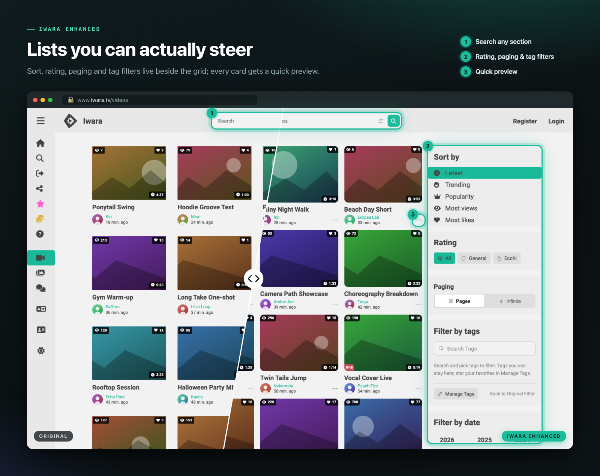
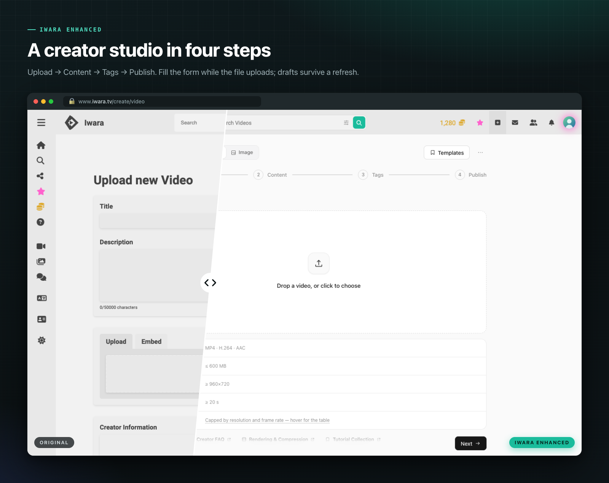
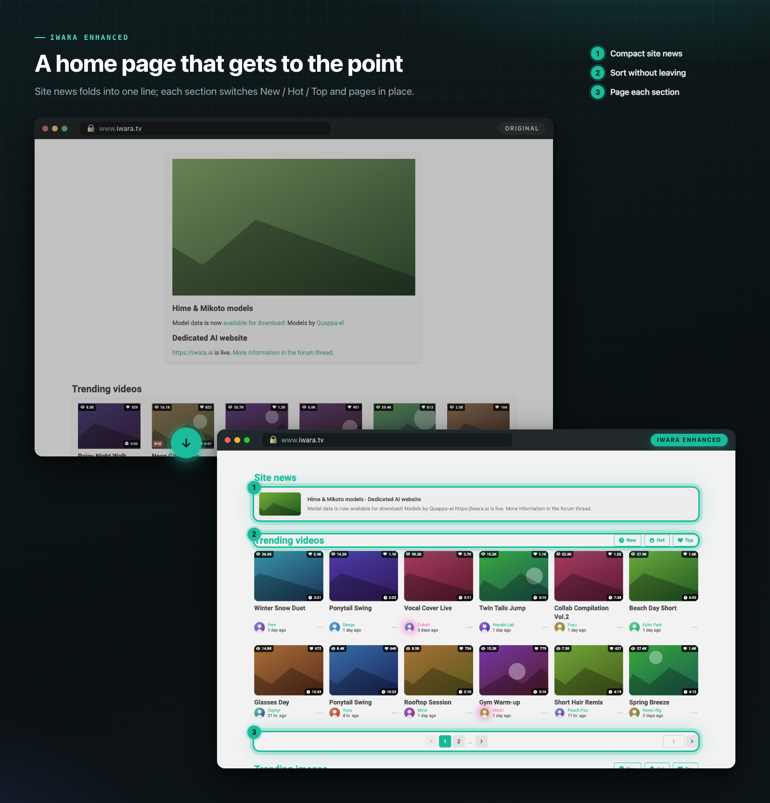
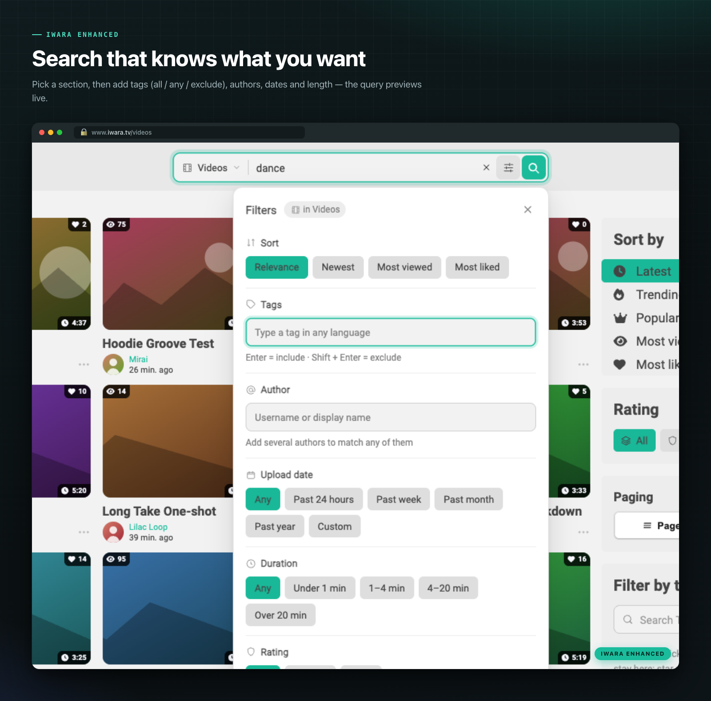
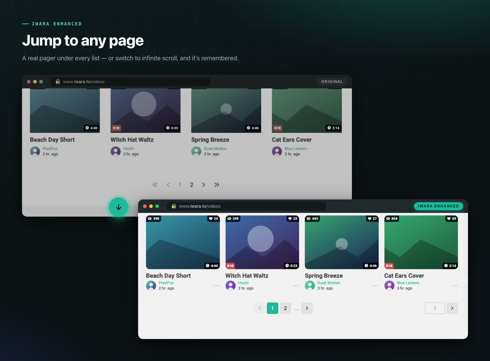
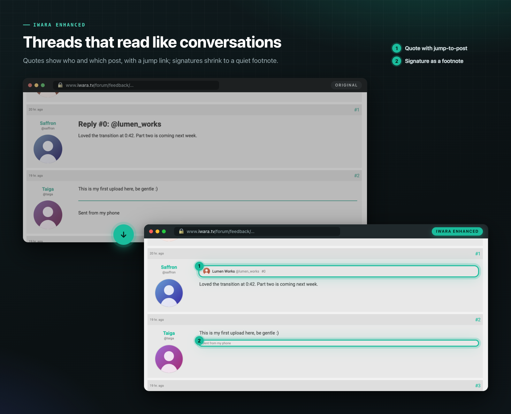
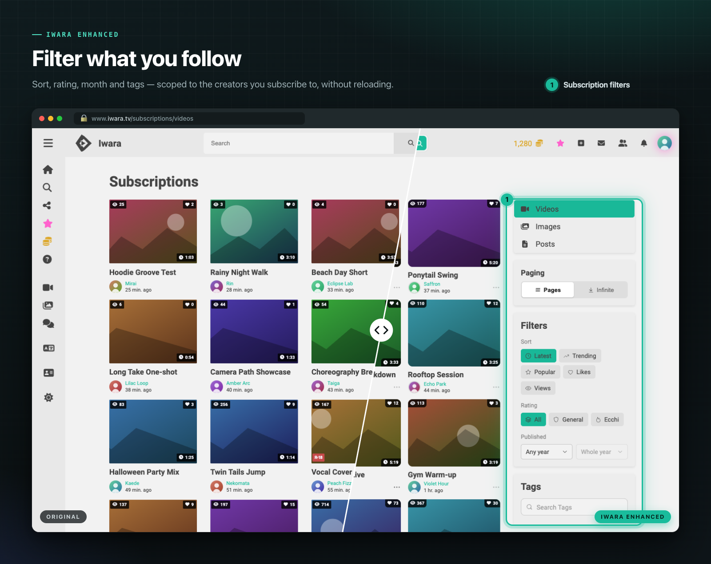
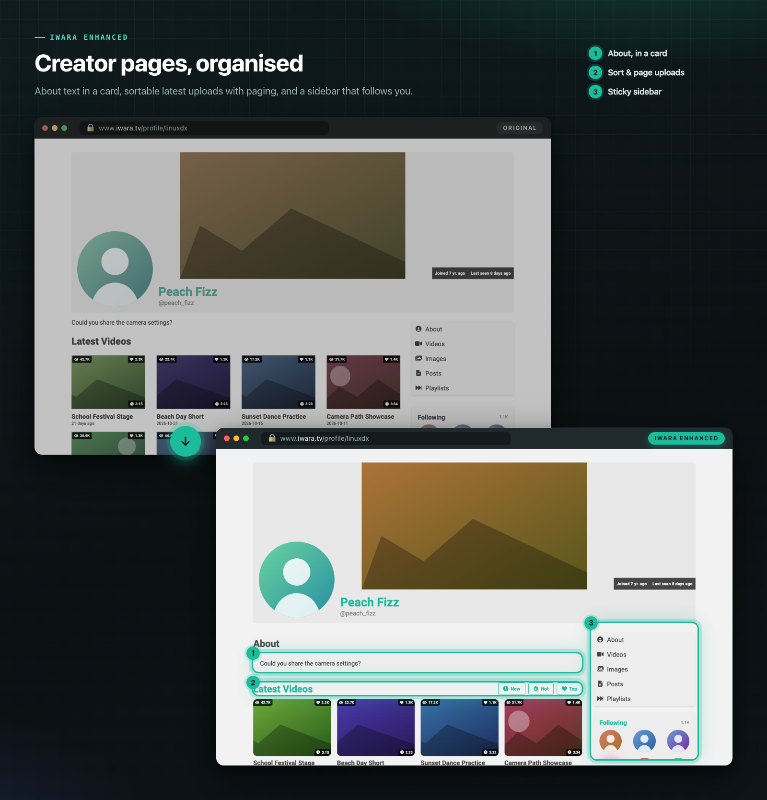
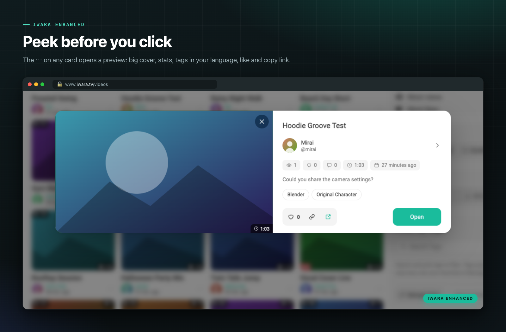
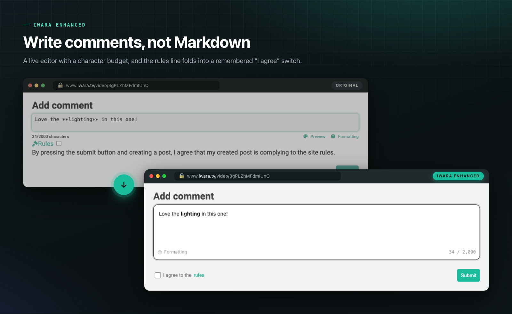

<div align="center">

# Iwara Enhanced

**An unofficial userscript that makes iwara.tv (and its AI site iwara.ai) nicer to browse and easier to publish on.**

**English** · [简体中文](README.zh-CN.md) · [日本語](README.ja.md)

[](LICENSE)
[](https://www.tampermonkey.net/)
[](https://www.iwara.tv)

</div>

<p align="center"></p>

---

## 🌟 About

**Iwara Enhanced** is a community userscript for the official iwara.tv website and its AI site iwara.ai. The original pages keep working exactly as before; the script adds what creators and viewers keep reaching for: a smoother publishing flow, easier content management, and better search and browsing.

> [!NOTE]
> This is an unofficial community project and is not affiliated with Iwara.

> [!IMPORTANT]
> **Play by the rules** — follow Iwara's site rules and content policy. Breaking them (for example by uploading test or unfinished content) can get your account warned or restricted.

> Every screenshot below is the real iwara.tv rendered twice — as shipped, and with the script — on the same **made-up data**: titles, names, text, tags, covers and avatars are placeholders.

## ✨ Features

### 🖊️ Creator studio

The video and image upload, edit and manage pages become one step-by-step studio.

<p align="center"></p>

- **Four steps**: Upload → Content → Tags → Publish
  - A video starts uploading as soon as you pick it; fill in the form while it uploads
  - Once uploaded it is saved as a draft — refreshing the page doesn't mean uploading again
- **What-you-see-is-what-you-get editing**
  - Markdown under the hood (Enter for a new paragraph, Shift+Enter for a line break)
  - `@` mentions and links to your own works
  - `Tab` jumps to the next blank to fill in
- **Smart tags**
  - Search in English, Simplified Chinese, Traditional Chinese or Japanese
  - Videos and galleries each need one category
  - Tags you've used are kept under "Recently used"
  - The dictionary comes from [LoveIwara](https://github.com/FoxSensei001/LoveIwara/tree/master/tool/data/iwara_tags) (`tool/data/iwara_tags`); everything except English is machine-translated
- **Covers**
  - Pick from the frames the server generated
  - Premium members can upload a custom cover
- **Templates**
  - Titles can hold `{blank}` placeholders and an auto-incrementing `{#}` episode number
  - Apply a template at any step
  - Save what you have as a new template, before or after publishing
- **Content manager**
  - A card wall with cover thumbnails
  - Search, sort and stats
  - Shows the separate upload cooldowns for videos and galleries

### 🏠 Home page

<p align="center"></p>

- Site news folds into one compact line.
- Each section (videos, images…) switches New / Hot / Top and pages in place.

### 🔍 Search

<p align="center"></p>

- The header search box lets you pick a section first (videos, galleries, posts, users…). The search results page has its own full search bar, so the header box is hidden there.
- On the results page, the keyword is whatever is in the search box right now: clear it and change a filter, and the search uses only the filters.
- The advanced panel supports several tags (all / any), excluded tags, authors, exact phrases, dates, rating and sort, with a live preview of the query it builds.

### 📄 Pagination

<p align="center"></p>

- List pages get a classic pager that can jump to any page.
- Video and gallery lists can switch to infinite scroll instead; your choice is remembered.

### 👤 User badges

- Avatars get a ring by role: a gradient ring with a soft glow for Premium, red for admins, green for moderators, grey for restricted users.
- Profiles show a role badge.

### 💬 Comments and posts

<p align="center"></p>

- Forum quotes become a quote bar with avatar, name and a "jump to post" link.
- Signatures shrink to a small grey footnote, and site emoji render at a sensible size.
- Only the display changes — how messages are sent is untouched.

### 🏷️ Tag translation and filters

- Tag links on video, gallery and other pages show in your language (from the dictionary); hover to see the original.
- Video and gallery lists can be filtered by several tags at once (all), picked from your recent tags and the tags on the current list.

### 📬 Subscriptions

<p align="center"></p>

- The videos and images tabs of Subscriptions get a "Filters" card and a "Tags" card on the right: sort (Latest by default, plus Trending / Popular / Likes / Views), rating (All by default), year and month, and tag filtering (all). Each card has a one-click reset.
- Filters only apply to the creators you follow and switch without reloading; videos and images share the same filters.
- Save tag combinations you use often — they work on videos, galleries and subscriptions alike.
- Video and gallery lists get a "Rating" card on the right (All / General / Ecchi), so you don't have to change the site-wide rating in the sidebar; it follows the sidebar setting by default.
- On narrow screens the cards start collapsed — tap a title to open one.

### 🙋 Creator pages

<p align="center"></p>

- Click the banner or avatar to view the full image (the same viewer as image pages; swipe between the two).
- Under the @username you'll see follower and following counts, linking to the lists; the friend button's "Pending" reads "Requested".
- About tab: the bio sits in a card; the "Latest videos / images" headings are links, with New / Hot / Top buttons for each sort and a pager under every section that pages in place; the comments heading shows the count.
- The videos and images tabs get "Filters" (sort, year and month), "Paging" (pager / infinite) and "Tags" cards on the right — like Subscriptions, they switch without reloading.
- On wide screens the sidebar stays in view as you scroll; Following / Followers show users as cards.
- After paging or switching tabs the page returns to just under the header (the top of the list), not the very top.
- On phones the banner and avatar shrink and the tabs become one horizontally scrolling row.

### 🃏 Card preview

<p align="center"></p>

- A "⋯" at the end of the author row on every video and gallery card opens a preview without leaving the list: a large cover (videos play their animated preview), the full title, author, stats (R-18 / private / views / likes / comments / length / image count / date), description and tags in your language.
- Galleries can be paged inside the card (swipe, trackpad, arrow keys or the hover arrows); click an image to open it in the full viewer.
- Bottom row: like, copy link, open in new tab, open.
- Wide screens show the cover on the left and details on the right; on phones it's a bottom sheet you can drag down to close.

### ✅ Rich editor and rules agreement

<p align="center"></p>

- Every Markdown box on the site (comments, replies, forum posts, edits) becomes the same live editor as the studio, with the box's character limit shown as "used / limit".
- The long "Rules ☐ By pressing the submit button… I agree…" line folds into a small "☐ I agree to the rules" switch next to the submit button, which remembers your last choice (unchecked if you never checked it).
- The site's own checkbox is only ticked at the moment you submit, so opening a page no longer marks the form as changed and "Leave this page?" stops interrupting you.
- Submitting without agreeing tells you to check the box instead of failing silently.

### 🌐 Translation

- Comments, forum posts, posts, profile bios, the home page announcement, video / image titles with descriptions, and the card preview get a translate button in their own action area (next to Reply, the post number, Like / Share, the bio heading, the announcement dialog's title bar, or the preview's bottom button row). It uses Google Translate into the site's current language.
- Mixed-language content (such as an announcement with an English paragraph and a Chinese one) also gets a button; only the foreign lines are translated.
- The translate button is a split button: the left part translates / shows the original, the arrow on the right opens a language menu (15 languages). Picking one translates that item right away and becomes the default from then on; until you pick one, it follows the interface language.
- The translation replaces the text in place, keeping line breaks, links, bold, emoji and inline code; click again to show the original. Content that is already in your language, or is only emoji or links, gets no button.
- Loading and failures show on the button itself; results are cached for the session.

### 🧭 Sidebar

- Language, rating and theme become icon switches at the bottom of the sidebar; the theme adds "Follow system".
- Forum gets a sub-menu whose "Recent" lists the newest threads across all boards.

## 📋 Goals and limits

- Make the website more convenient for everyday viewers and creators: smoother publishing, editing and managing.
- Serve only the official Iwara website; no content from any other site is pulled in.
- Nothing that hurts the official site, such as removing ads.

## 🛠️ Install

1. Install [Tampermonkey](https://www.tampermonkey.net/) (Chrome, Firefox, Safari…) or [Violentmonkey](https://violentmonkey.github.io/)
2. Create a new script in the manager and paste the whole of `dist/iwara-enhanced.user.js`
3. Open iwara.tv or iwara.ai — the script activates automatically

A browser-extension build of the same code is described in [extension/README.md](extension/README.md).

**Upgrading from an old version**: the script's name and namespace have changed. Uninstall the old script first, then install this one — don't update over the old one. The script now runs at `document-start`.

**Tip**: the "⋯" menu at the top right of the studio lets you
- switch back to the original page
- replay the feature tour

## ✅ What it does and doesn't do

**Does:**
- Runs only on `iwara.tv` and `iwara.ai` (the AI site runs the same front end against the same API), using the site's own login and front-end APIs (upload, create, edit, delete, cooldowns, tag and user suggestions)
- Stores templates and drafts in the site's `localStorage` (keys start with `iwe:`)
- Makes only two kinds of outside requests: downloading the tag dictionary from jsDelivr, and — only when you click translate — sending that text to Google Translate (`translate.googleapis.com`)
- Everything else goes to the site's own `api.iwara.tv`

**Doesn't:**
- Tick "I have read and agree to the site rules" before publishing for you — you do that yourself
- Get around or change the site's moderation policy

## ⚠️ Known limits

- Once a video has a custom cover saved, it can't go back to a video frame — only to another image (server limitation)
- The site caches detail responses: after you save an edit, other people may see the update only after a while; the script trusts the save result and never overwrites it with stale data
- Upload limits, bitrate tables and format notes follow the site's upload page; if the site changes, the script may need an update
- iwara.tv and iwara.ai keep separate browser storage, so settings, templates and drafts don't carry over between them; use the template panel's export / import to move templates

## 👨‍💻 Development

```bash
npm install
node build.mjs
```

**Layout:**
- Sources live in `src/` and are concatenated in file-name order into a single script in `dist/`
- The editor is the open-source [Milkdown](https://milkdown.dev) (MIT, built on ProseMirror)
- esbuild bundles `vendor/milkdown.js` into the same file, so installing needs no extra network requests

**Screenshots**: `docs/screenshots/capture.mjs` renders the real site with and without the script (English UI, made-up data) and lays out the images in `docs/images/`. See the comment at the top of that file for how to run it.

## 📄 License

MIT, see [LICENSE](LICENSE).
